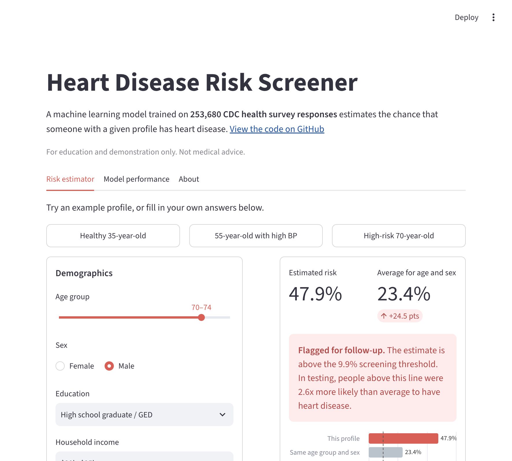
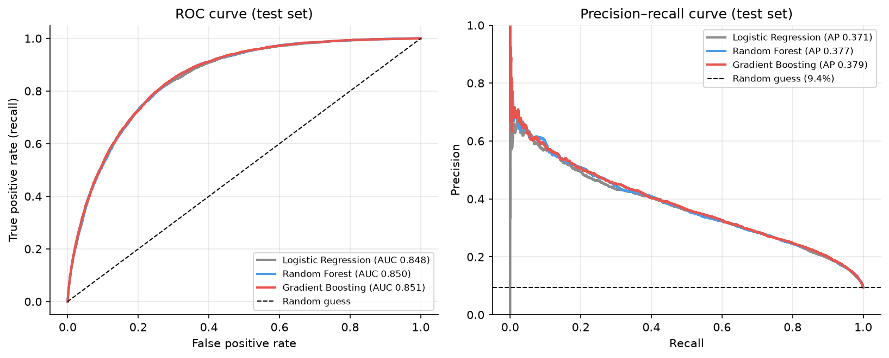
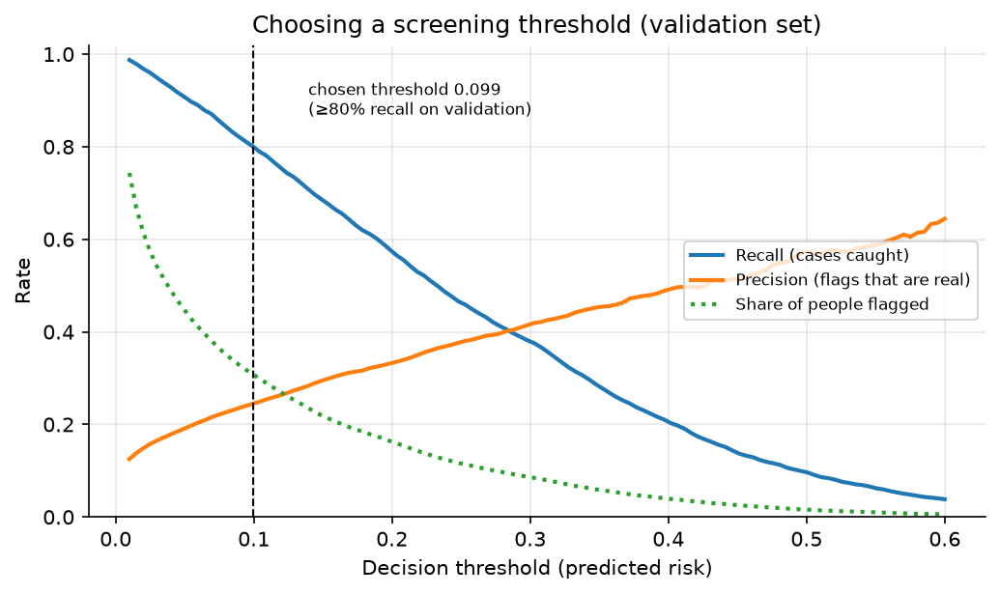
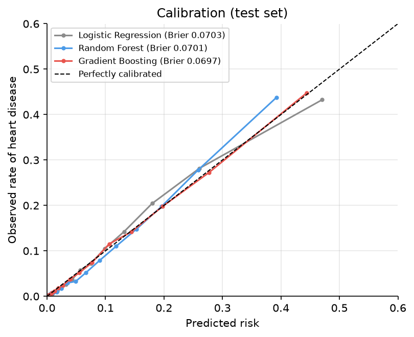
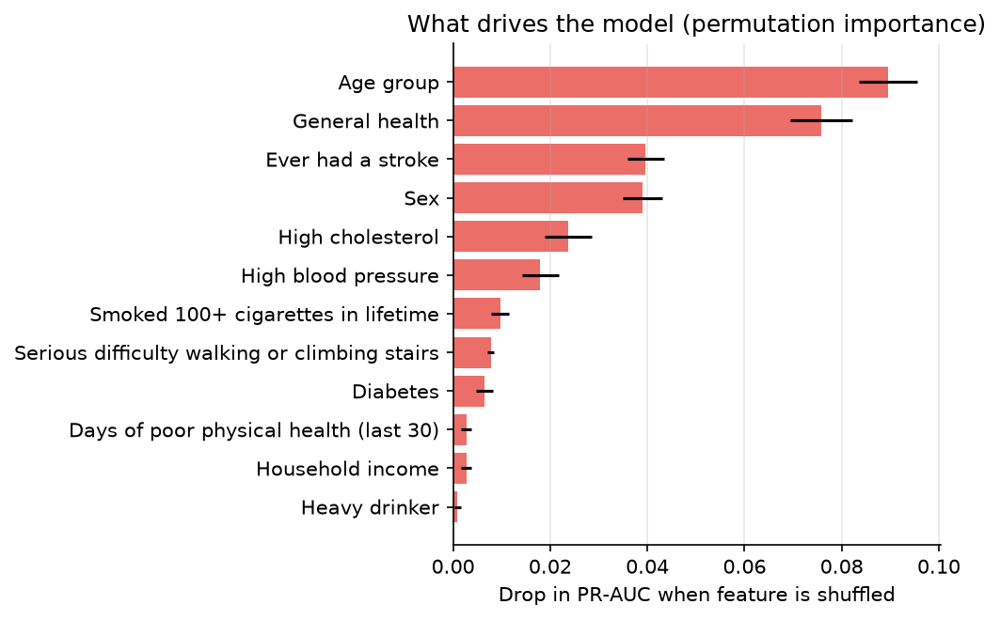

# Heart Disease Risk Screener

[](https://github.com/arshmann2003/HeartDiseaseClassifier/actions/workflows/ci.yml)
[](https://heart-risk-screener.streamlit.app/?ref=github)

A machine learning screening tool that estimates the chance that a person has heart disease from
21 lifestyle and health survey answers. It is trained on **253,680 responses** to the CDC's 2015
Behavioral Risk Factor Surveillance System (BRFSS).

**Live demo: [heart-risk-screener.streamlit.app](https://heart-risk-screener.streamlit.app/?ref=github)**
<sub>If the app is asleep, click "Yes, get this app back up!" and it loads in about 30 seconds.</sub>



## Results

All results are on a **held-out test set of 50,736 people**. That set was never used for training,
model selection, or choosing the decision threshold.

| Model | ROC-AUC | PR-AUC | Brier score | Recall | Precision |
|---|---|---|---|---|---|
| Logistic regression | 0.848 | 0.371 | 0.0703 | 81.2% | 24.0% |
| Random forest | 0.850 | 0.377 | 0.0701 | 80.8% | 24.3% |
| **Gradient boosting (deployed)** | **0.851** | **0.379** | **0.0697** | **81.0%** | **24.4%** |

Recall and precision are measured at each model's screening threshold. That threshold is the
highest one that still catches at least 80% of true cases on the validation set.

**What this means.** The model flags 31% of people and catches 3,868 of the 4,778 people with heart
disease. About 1 in 4 flagged people actually has it. That is 2.6x the 9.4% base rate. This trade-off
fits a cheap first-pass screen that is followed by a real check-up. It is not a diagnosis.



| Choosing the threshold | Calibration |
|---|---|
|  |  |

### Key findings

- **Age and self-rated general health are the strongest predictors.** Prior stroke, sex, high
  cholesterol, and high blood pressure follow. Lifestyle factors such as diet and alcohol add
  little once these are known.
- **A tuned gradient boosting model barely beats logistic regression** (0.851 vs 0.848 ROC-AUC).
  The signal in these 21 survey answers is mostly additive. A simple, interpretable model would be
  a perfectly reasonable production choice.
- **The predicted risks are well calibrated.** None of the models use class weighting, so a
  predicted 20% risk really does correspond to about 20% of people. That matters because the app
  shows people their probability, not just a yes or no.
- **Unsupervised analysis found a clear high-risk group.** K-means split respondents into two
  groups. The smaller group (27% of people) had a 22.9% heart disease rate, versus 4.6% in the
  larger one. It was defined by poor general health, difficulty walking, and high blood pressure.



## What I fixed from the first version

This project started as a CMPT 459 (Data Mining) course project. The [original analysis
notebook](notebooks/02_analysis_pipeline.ipynb) reported "98% recall." When I revisited it, I found
problems in how the model was evaluated:

| Problem in the original | Fix |
|---|---|
| The decision threshold was tuned on the **test set**, so the test results were optimistic (data leakage). | Three-way train / validation / test split. The threshold is chosen on validation data only. |
| The "best" threshold (0.10) sat at the lowest value the search allowed. | Thresholds are derived from the full precision-recall curve to meet an explicit recall target. |
| 98% recall came with **13% precision and 40% accuracy**: the model flagged nearly everyone. | Report precision, recall, and PR-AUC together, and pick the operating point on purpose. |
| Cross-validation measured accuracy, which a model that always predicts "no" scores 90.6% on. | Model selection uses PR-AUC, which is suited to imbalanced data. |
| Class weighting distorted predicted probabilities. | No class weighting, and a calibration check. |
| No simple baseline. | Compared against logistic regression. |

The fixed pipeline improves test ROC-AUC from 0.83 to 0.85. At ~80% recall, precision rises from
22% to 24% of flags being real cases. (The original's numbers come from its own split, so the
comparison is approximate.)

## How it works

```
data/ (BRFSS 2015 CSV, downloaded automatically)
   │
   ▼
train.py ── 60/20/20 stratified split
   │        ├─ fit logistic regression, random forest, gradient boosting (randomized search, 3-fold CV)
   │        ├─ select the model with the best validation PR-AUC
   │        ├─ choose the threshold reaching 80% recall on validation
   │        └─ score the test set once; permutation importance; figures
   ▼
models/heart_risk_model.joblib + metadata.json   ──►   app.py (Streamlit)
```

The web app explains each estimate by replacing one answer at a time with the most common survey
answer and measuring how much the predicted risk changes.

**Usage analytics.** The app logs anonymous events (visits, example profiles clicked, whether
answers were edited) to a Supabase Postgres table, tagged with the `?ref=` value of the link the
visitor used. Events are sent from a background thread so the app never waits on the network. The
table's row-level security lets the app's public key insert known event types only, with no read
access, and health answers are never sent. See [`supabase/schema.sql`](supabase/schema.sql), the
`visits` and `daily_visits` views in [`supabase/views.sql`](supabase/views.sql), and the reports in
[`supabase/queries.sql`](supabase/queries.sql).

## Run it locally

```bash
git clone https://github.com/arshmann2003/HeartDiseaseClassifier.git
cd HeartDiseaseClassifier
python -m venv .venv && source .venv/bin/activate
pip install -r requirements-dev.txt

streamlit run app.py      # web app (uses the trained model in models/)
python train.py           # retrain from scratch (~1 min; downloads the data from Kaggle)
pytest                    # tests
```

`train.py` downloads the [Kaggle dataset](https://www.kaggle.com/datasets/alexteboul/heart-disease-health-indicators-dataset)
with `kagglehub`. You can also place `heart_disease_health_indicators_BRFSS2015.csv` in `data/`
yourself.

## Project structure

```
├── app.py                  # Streamlit web app
├── train.py                # Reproducible training and evaluation pipeline
├── heart_risk/             # Feature schema, modeling and explanation code
├── models/                 # Trained model and metadata (metrics, threshold, reference values)
├── reports/figures/        # Evaluation plots generated by train.py
├── tests/                  # Model and app tests (run in CI)
├── scripts/keep_alive.py   # Scheduled visit that keeps the hosted demo from sleeping
├── supabase/               # Analytics table schema, access policy and report queries
├── notebooks/              # Original exploratory analysis (EDA, clustering, outliers, feature selection)
├── analysis/               # Modules used by the notebooks
└── docs/Report.pdf         # Original course report
```

## Limitations

- The data is self-reported, from US adults in 2015 only.
- The target is *having had* coronary heart disease or a heart attack, not developing it later.
  Some inputs, such as difficulty walking, may be results of heart disease rather than causes. A
  clinical risk model would need follow-up data.
- Feature effects shown in the app are statistical associations, not causal effects.

---

Built by **Arshdeep Mann**
